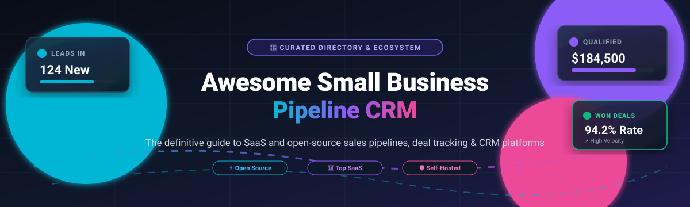

# 🚀 Awesome Small Business Pipeline CRM 💼

  
  
  
  
  

> 🌟 A curated directory and ecosystem guide of top **Small Business Pipeline CRM** platforms — covering both commercial SaaS solutions and self-hosted open-source software for managing sales pipelines, lead lifecycles, and deal tracking without enterprise bloat. 🎯

Looking for the best sales pipeline CRM for small businesses, agencies, and startups? This comprehensive directory compares commercial SaaS options and self-hosted open-source software, detailing pricing tiers, free tier limits, company valuation/revenue, and community traction. ✨

---

## 📋 Table of Contents

- [📈 Sector Overview & Market Dynamics](#-sector-overview--market-dynamics)
- [🟦 SaaS / Hosted Platforms](#-saas--hosted-platforms)
- [🟩 Open-Source Software](#-open-source-software)
  - [Twenty](#twenty)
  - [Krayin CRM](#krayin-crm)
  - [Idurar ERP / CRM](#idurar-erp--crm)
  - [SuiteCRM](#suitecrm)
  - [Frappe CRM](#frappe-crm)
  - [EspoCRM](#espocrm)
  - [Atomic CRM](#atomic-crm)
  - [RealTimeX CRM](#realtimex-crm)
  - [Hermit CRM](#hermit-crm)
  - [amagi-crm](#amagi-crm)
- [📊 Comparison at a Glance](#-comparison-at-a-glance)
- [🤝 Contributing](#-contributing)
- [💖 Support & Sponsorship](#-support--sponsorship)
- [⭐ Star History](#-star-history)
- [📄 License](#-license)

---

## 📈 Sector Overview & Market Dynamics

The global CRM software market is valued at approximately **$113B–$128B (2024–2025)** and is projected to surpass **$140B+ by 2027**, growing at a steady compound annual growth rate (CAGR) of 11–12%. 📊 While the enterprise tier remains **moderately concentrated** among tech giants (Salesforce capturing ~20% market share alongside Microsoft, Oracle, and SAP), the small business pipeline CRM sector is **highly fragmented**, creating vibrant competition among user-friendly, specialized SaaS providers and rapidly emerging self-hosted open-source alternatives. 🚀

---

## 🟦 SaaS / Hosted Platforms

Commercial, cloud-hosted Small Business Pipeline CRM platforms sorted in descending order by estimated company valuation / annual revenue scale. 🏢

| Platform | Company Scale (Valuation / Revenue) | Starting Price (Paid Tiers) | Free Tier Limits / Free Trial | Best For |
|---|---|---|---|---|
| [**HubSpot CRM**](https://www.hubspot.com/products/crm) | **$10B+ market cap** (~$3.1B annual revenue) | **$20/seat/month** (Starter Sales Hub, billed monthly; discounts with annual commitment) | **Free Forever Plan**: Up to 2 users, 1,000 contacts, 1 deal pipeline, 2,000 marketing emails/month (HubSpot branded) | Free entry point with extensive marketing and sales growth tools 🧲 |
| [**Zoho Bigin**](https://www.bigin.com/) | **~$12B–$12.5B private valuation** (~$1.5B revenue, Zoho Corp) | **$7/user/month** (Express plan, billed annually; or $9/user/month billed monthly) | **Free Forever Plan**: 1 user only, up to 500 records total, 1 pipeline, 3 workflow automations | Micro-teams and solopreneurs migrating off spreadsheets 📑 |
| [**Copper**](https://www.copper.com/) | **$3B peak valuation** (~$41M annual revenue) | **$23/user/month** (Basic plan, billed annually; or $29/user/month billed monthly) | **14-day free trial** (Full feature access, no credit card required; no permanent free tier) | Google Workspace & Gmail-native sales teams 📬 |
| [**Pipedrive**](https://www.pipedrive.com/) | **$1.5B acquisition valuation** (~$190M annual revenue) | **$14/user/month** (Essential plan, billed annually; or $24/user/month billed monthly) | **14-day free trial** (Full feature access, no credit card required; no permanent free tier) | Visual activity-based pipeline and deal management 🎯 |
| [**Insightly**](https://www.insightly.com/) | **$38M+ funding raised** (~$25M–$37M annual revenue) | **$29/user/month** (Plus plan, billed annually) | **14-day free trial** (Full feature access, no credit card required; free tier discontinued) | Deal tracking with built-in post-sale project management 📁 |
| [**Nutshell**](https://www.nutshell.com/) | **~$11M annual revenue** (Bootstrapped / growth capital) | **$13/user/month** (Foundation plan, billed annually; or $19/user/month billed monthly) | **14-day free trial** (Full feature access, no credit card required; no permanent free tier) | Sales pipeline tracking with integrated email drip sequences ✉️ |
| [**Capsule CRM**](https://capsulecrm.com/) | **~$7M annual revenue** (Profitable bootstrapped) | **$18/user/month** (Starter plan, billed annually; or $21/user/month billed monthly) | **Free Forever Plan**: Up to 2 users, 250 contacts, 1 sales pipeline, 5 custom fields | Lightweight, simple contact and opportunity tracking 🗂️ |
| [**Less Annoying CRM**](https://www.lessannoyingcrm.com/) | **~$4M ARR** (Independently bootstrapped) | **$15/user/month** (Flat rate, no tiered pricing or hidden add-ons) | **30-day free trial** (Full unrestricted access, unlimited contacts/pipelines, no credit card required; no permanent free tier) | Solopreneurs and small businesses wanting zero complexity 🧘 |
| [**Pipeline CRM**](https://www.pipelinecrm.com/) | **<$10M ARR** (Private SMB specialist) | **$25/user/month** (Start plan, billed annually; or $29/user/month billed monthly) | **14-day free trial** (Full feature access, no credit card required; no permanent free tier) | Structured sales pipeline forecasting and deal acceleration 📈 |
| [**Genaya**](https://genaya.com/) | **Early-stage, private** | **$99/month** (Individual plan, 1 user; Pro $249/month for 3 users) | **14-day free trial** (Card required; no permanent free tier) | Service businesses running leads, pipeline, calls, texts, estimates, and invoices in one app 📞 |

---

## 🟩 Open-Source Software

Self-hosted, community-driven, and open-source Small Business Pipeline CRM systems. The table below is sorted by GitHub Stars_Counts (descending). 🌐

| Project | GitHub_Stars | Stack | License | Key Strengths |
|---|---|---|---|---|
| [**Twenty**](https://twenty.com) |  | TypeScript, React, NestJS, PostgreSQL | AGPL-3.0 | Modern Salesforce alternative; custom objects at runtime, Kanban boards, AI/MCP integration 🤖 |
| [**Krayin CRM**](https://krayincrm.com/) |  | PHP, Laravel, Vue.js, MySQL | MIT | Permissive MIT license; drag-and-drop Kanban, quotation engine, AI PDF lead extraction ⚡ |
| [**Idurar ERP / CRM**](https://www.idurarapp.com/) |  | JavaScript, Node.js, Express, React, MongoDB | MIT | Complete open-source sales pipeline, invoicing, accounting, and inventory for SMEs 🧾 |
| [**SuiteCRM**](https://suitecrm.com/) |  | PHP, Symfony, MariaDB/MySQL | AGPL-3.0 | Enterprise-grade maturity; visual pipeline, workflow studio, granular RBAC, large extension market 🏛️ |
| [**Frappe CRM**](https://frappecrm.com/) |  | Python, Frappe Framework, Vue.js | AGPL-3.0 | Modern, clean pipeline UI; seamless integration with Frappe/ERPNext ecosystem and WhatsApp/call logs 💬 |
| [**EspoCRM**](https://www.espocrm.com/) |  | PHP, MySQL, PostgreSQL | AGPL-3.0 | Lightweight, visual sales pipelines, modular architecture, fast deployment, REST API 🧩 |
| [**Atomic CRM**](https://marmelab.com/atomic-crm/) |  | TypeScript, React, Tailwind CSS, Supabase | MIT | Developer-first starter toolkit; Kanban pipeline, contact timelines, built on PostgreSQL/Supabase ⚛️ |
| [**RealTimeX CRM**](https://github.com/therealtimex/realtimex-crm) |  | React, TypeScript, Supabase | MIT | Atomic CRM fork with Bring-Your-Own-Database (BYOD) setup, email sync, and Kanban deal pipelines 🔄 |
| [**Hermit CRM**](https://github.com/Hermit-CRM/hermit-crm) |  | Python, Markdown files, Git | MIT | Git-native and file-based CRM; Markdown records, follow-up radar, local privacy, MCP server for AI 📝 |
| [**amagi-crm**](https://github.com/amagilabs/amagi-crm) |  | Python, SQLite / PostgreSQL | MIT | CLI-first CRM for solo founders; pipeline stage totals, appointment scheduling, tamper-evident audit chain 🔒 |

---

### Twenty
  
**Repository:** [twentyhq/twenty](https://github.com/twentyhq/twenty) 🌟  
**Stack:** TypeScript / NestJS / React / PostgreSQL / Redis | **License:** AGPL-3.0 ⚖️  
Twenty is a modern, open-source CRM positioned as a **Salesforce alternative** with Y Combinator backing. It features a flexible metadata layer for creating **custom objects and fields at runtime**, Kanban deal pipelines, table views, GraphQL and REST APIs, email/calendar sync, workflow automation with webhooks, and role-based permissions. It natively supports Model Context Protocol (MCP) for direct AI assistant integration (e.g. Claude or Cursor querying your CRM data via OAuth).  
**Best for:** Developer-friendly teams and growing businesses wanting a modern, highly extensible CRM with custom objects, AI integration via MCP, and zero vendor lock-in. 🚀

---

### Krayin CRM
  
**Repository:** [krayin/laravel-crm](https://github.com/krayin/laravel-crm) 🌟  
**Stack:** PHP / Laravel / Vue.js / MySQL | **License:** MIT ⚖️  
Krayin is a free, MIT-licensed Laravel CRM built specifically for SMEs and agencies. It provides comprehensive sales lifecycle management through a Vue.js single-page application, featuring:
- **Lead & Pipeline Management** — interactive drag-and-drop Kanban boards with deal probability, custom stages, and revenue forecasting. 📊
- **Contact & Organization Management** — full interaction history and timeline tracking. 👥
- **AI Lead Extraction** — automatically parse incoming lead details from uploaded PDFs, quotes, and images. 🤖
- **Quotation & Product Catalog** — generate and dispatch professional sales quotes directly from deal cards. 💼
- **Workflow Automation & REST API** — trigger webhooks and automate repetitive follow-up tasks. ⚡  
**Best for:** Small businesses and digital agencies seeking a feature-packed, MIT-licensed CRM with Kanban pipelines, quotation management, and AI lead extraction without per-user licensing fees. 🎯

---

### Idurar ERP / CRM
  
**Repository:** [idurar/idurar-erp-crm](https://github.com/idurar/idurar-erp-crm) 🌟  
**Stack:** JavaScript / Node.js / React / Express / MongoDB | **License:** MIT ⚖️  
Idurar is an open-source ERP/CRM application tailored for small and medium-sized enterprises. It combines visual sales pipelines and client management with built-in accounting, invoicing, quotes, payment tracking, and inventory control. Its modern Node/React architecture makes it easy for web developers to customize and self-host.  
**Best for:** Small service businesses, contractors, and agencies wanting a combined sales pipeline and billing/invoicing platform in a single open-source stack. 🧾

---

### SuiteCRM
  
**Repository:** [salesagility/SuiteCRM](https://github.com/salesagility/SuiteCRM) 🌟  
**Stack:** PHP / Symfony / MariaDB / MySQL | **License:** AGPL-3.0 ⚖️  
SuiteCRM is one of the most mature, battle-tested open-source CRM systems in the world (originally forked from SugarCRM). It offers enterprise-grade capabilities: customizable sales pipelines, workflow process automation, case and lead management, email campaigns, customer self-service portals, and deep role-based access control.  
**Best for:** Established small-to-mid businesses needing deep customization, complex process workflows, and a mature community ecosystem without proprietary license fees. 🏛️

---

### Frappe CRM
  
**Repository:** [frappe/crm](https://github.com/frappe/crm) 🌟  
**Stack:** Python / Frappe Framework / Vue.js / MariaDB | **License:** AGPL-3.0 ⚖️  
Frappe CRM is a dedicated, modern sales CRM built by the creators of ERPNext. It features an intuitive, fast UI with visual deal pipelines, omni-channel communication tracking (emails, WhatsApp, phone call logs), automated lead assignments, and customizable SLA views. It integrates natively with the broader Frappe ecosystem.  
**Best for:** Small businesses and fast-moving sales teams wanting a clean, snappy, modern open-source pipeline CRM with out-of-the-box WhatsApp and email communication. 💬

---

### EspoCRM
  
**Repository:** [espocrm/espocrm](https://github.com/espocrm/espocrm) 🌟  
**Stack:** PHP / MySQL / PostgreSQL | **License:** AGPL-3.0 ⚖️  
EspoCRM is known for its fast performance, intuitive interface, and clean modular architecture. Features include visual sales pipelines with customizable stages, automated email sync via IMAP/SMTP, lead-to-opportunity conversions, workflow automation, and a comprehensive REST API. Self-hosted instances have no user limitations.  
**Best for:** Growing startups and service firms wanting a flexible, low-maintenance self-hosted CRM with drag-and-drop deal tracking and workflow automation. 🧩

---

### Atomic CRM
  
**Repository:** [marmelab/atomic-crm](https://github.com/marmelab/atomic-crm) 🌟  
**Stack:** TypeScript / React / Tailwind CSS / Supabase | **License:** MIT ⚖️  
Atomic CRM, engineered by Marmelab, is an open-source, full-featured CRM template built using React Admin, Supabase (PostgreSQL), and Tailwind CSS. It delivers an out-of-the-box Kanban deal pipeline, contact activity timelines, notes, reminders, and user permission controls.  
**Best for:** React and TypeScript developers who want a lightweight, modern codebase they can completely adapt, host on Supabase, and maintain with zero recurring licensing overhead. ⚛️

---

### RealTimeX CRM
  
**Repository:** [therealtimex/realtimex-crm](https://github.com/therealtimex/realtimex-crm) 🌟  
**Stack:** React / TypeScript / Supabase | **License:** MIT ⚖️  
RealTimeX CRM is an enhanced fork of Atomic CRM focusing on Bring-Your-Own-Database (BYOD) deployment. It provides Kanban deal pipelines, contact organization, tasks and reminders, notes, email capture (via CRM CC address), and OAuth login (Google, Azure, Keycloak, Auth0).  
**Best for:** Development teams needing a React-based CRM deployable with custom database endpoints and turnkey OAuth integration. 🔄

---

### Hermit CRM
  
**Repository:** [Hermit-CRM/hermit-crm](https://github.com/Hermit-CRM/hermit-crm) 🌟  
**Stack:** Python / Markdown files / Git | **License:** MIT ⚖️  
Hermit CRM is a **file-based, Git-native CRM** where every company, contact, and interaction is stored as a Markdown file in a directory tree, using Git for revision history and synchronization. Features include pipeline boards with customizable stages, a follow-up radar, company timelines, CSV/Excel import, and an MCP server for AI agent integration.  
**Best for:** Technical founders, developers, and solopreneurs wanting complete data ownership in plaintext Markdown without running a database server. 📝

---

### amagi-crm
  
**Repository:** [amagilabs/amagi-crm](https://github.com/amagilabs/amagi-crm) 🌟  
**Stack:** Python / SQLite or PostgreSQL | **License:** MIT ⚖️  
amagi-crm is a lightweight, CLI-first CRM designed for solo operators and small firms. It runs on a single SQLite file or PostgreSQL via Docker Compose, offering pipeline deal tracking with stage totals, appointment scheduling with overlap detection, contact CSV imports, and a tamper-evident cryptographic audit chain.  
**Best for:** Technical operators and solo founders looking for a minimalist, single-file CRM with cryptographic audit verification and terminal workflows. 🔒

---

## 📊 Comparison at a Glance

| Software | Model | License / Cloud | Visual Pipeline | Email Sync | Key Differentiator |
|---|---|---|---|---|---|
| **HubSpot CRM** | SaaS | Proprietary (Free tier) | ✅ Drag-and-drop | ✅ Native | Robust free tier with seamless marketing/sales ecosystem 🧲 |
| **Zoho Bigin** | SaaS | Proprietary (Free tier) | ✅ Pipeline-first | ✅ Native | Affordable entry point for micro-businesses 📑 |
| **Copper** | SaaS | Proprietary | ✅ Visual | ✅ Gmail-native | Zero-data-entry workflow embedded inside Google Workspace 📬 |
| **Pipedrive** | SaaS | Proprietary | ✅ Visual Kanban | ✅ 2-way sync | Activity-based selling methodology and clean pipeline focus 🎯 |
| **Insightly** | SaaS | Proprietary | ✅ Visual | ✅ Native | Built-in project management linked to won deals 📁 |
| **Nutshell** | SaaS | Proprietary | ✅ Multiple views | ✅ Automated sequences | Built-in email drip marketing and sales pipeline automation ✉️ |
| **Capsule CRM** | SaaS | Proprietary (Free tier) | ✅ Visual | ✅ Gmail/Outlook | Simple, uncluttered contact & pipeline tracking 🗂️ |
| **Less Annoying CRM** | SaaS | Proprietary | ✅ Pipeline stages | ✅ Email logging | $15 flat rate, no tiers, designed specifically for micro-teams 🧘 |
| **Pipeline CRM** | SaaS | Proprietary | ✅ Deal tracking | ✅ Native | Dedicated sales forecasting and deal velocity tracking 📈 |
| **Twenty** | Open Source | AGPL-3.0 | ✅ Kanban & Table | ✅ Gmail / IMAP | Modern extensible Salesforce alternative with AI/MCP support 🤖 |
| **Krayin CRM** | Open Source | MIT | ✅ Kanban + Probability | ✅ SendGrid / SMTP | Permissive MIT license, quotation engine & AI lead extraction ⚡ |
| **Idurar** | Open Source | MIT | ✅ Kanban | ✅ Email templates | Integrated CRM, billing, invoicing, and inventory for SMEs 🧾 |
| **SuiteCRM** | Open Source | AGPL-3.0 | ✅ Visual Studio | ✅ IMAP / SMTP | Enterprise workflows, customer portal, deep RBAC 🏛️ |
| **Frappe CRM** | Open Source | AGPL-3.0 | ✅ Kanban | ✅ Email / WhatsApp | Modern UI, WhatsApp integration, native Frappe/ERPNext sync 💬 |
| **EspoCRM** | Open Source | AGPL-3.0 | ✅ Visual Kanban | ✅ IMAP / SMTP | Lightweight, modular architecture, fast setup 🧩 |
| **Atomic CRM** | Open Source | MIT | ✅ Kanban | ✅ Email capture | Developer template built on React and Supabase ⚛️ |
| **RealTimeX** | Open Source | MIT | ✅ Kanban | ✅ Email capture | BYOD React/Supabase pipeline CRM with turnkey OAuth 🔄 |
| **Hermit CRM** | Open Source | MIT | ✅ Text & Board | 📁 Markdown files | Git-native, local Markdown storage with MCP AI server 📝 |
| **amagi-crm** | Open Source | MIT | ✅ Stage totals | ⚙️ CLI / Scripts | Single SQLite file database with cryptographic audit chain 🔒 |

---

## 🤝 Contributing

Contributions are warmly welcomed! 🤝 If you know of an outstanding Small Business Pipeline CRM (especially active open-source projects or notable SaaS platforms tailored for small teams), please feel free to contribute:

1. 🍴 Fork the repository.
2. 🌿 Create a descriptive feature branch (`git checkout -b add-my-crm`).
3. ✍️ Add the project details with name, URL, pricing/license, tech stack, and key strengths.
4. 🚀 Submit a Pull Request.

Please ensure submitted projects are actively maintained (commits or releases within the past 12 months) and relevant to sales pipelines and CRM workflows.

---

## 💖 Support & Sponsorship

If you find this curated directory helpful for evaluating or building your sales pipeline stack, please consider supporting the project:

- ⭐ **Star this repository** to show your appreciation and boost its visibility on GitHub!
- 🍴 **Fork and share** it with fellow entrepreneurs, developers, and sales professionals.
- ☕ **Buy me a coffee / Sponsor**: If you'd like to back ongoing maintenance and new features, please visit the [**GitHub Sponsors Dashboard**](https://github.com/sponsors/ishandutta2007). Your support is deeply appreciated! 💖

---

## 📈 Star History

---

## 📄 License

This repository is made available under the [Creative Commons Zero v1.0 Universal](LICENSE) (CC0 1.0) Public Domain Dedication. Listed third-party software, project names, and trademarks remain the property of their respective owners. ⚖️
